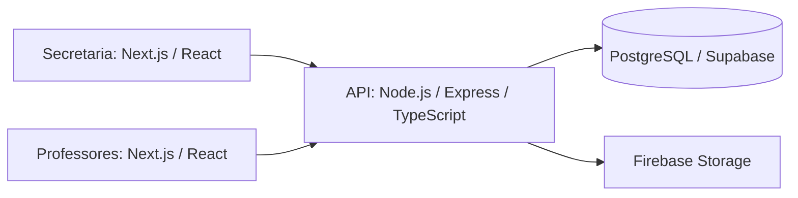

# SEMG.edu - Aplicação de secretaria

O SEMG.edu é uma solução de gestão escolar implementada por Samuel Oliveira no ambiente da Fábrica Escola de Software MAMBEE/IFPI, com orientações pontuais de professores sobre problemas técnicos e tecnologias.

Foi disponibilizado para usuários reais em uma escola com aproximadamente 200 alunos, 20 professores e uma equipe de gestão e secretaria. **Atualmente não está mais em utilização pela escola.** As métricas de utilização são informações fornecidas pelo autor, não medições extraídas do código.

A solução reúne cadastro de alunos e professores, turmas, matrículas, avaliações, notas e rotinas administrativas. Não implica que todo fluxo esteja completo ou validado automaticamente.

## Arquitetura da solução


- [Backend compartilhado](https://github.com/SamuelOliveira-M/SEMG-Edu-Backend)
- [Aplicação da secretaria](https://github.com/SamuelOliveira-M/semg.edu-nextJS)
- [Aplicação dos professores](https://github.com/SamuelOliveira-M/Semg.edu-TeacherView)

Esta aplicação é a interface de secretaria. Utiliza Next.js 14, React 18, TypeScript e Tailwind CSS. A presença de outras dependências no manifesto não é prova de que todas sejam utilizadas em funcionalidades completas.

## Estrutura

```text
app/                 rotas e componentes do App Router
app/lib/api.ts       chamadas à API compartilhada
app/lib/actions.ts   ações e fluxo de autenticação/formulários
app/lib/definitions.ts  tipos de dados
public/              arquivos estáticos
middleware.ts        integração do fluxo de sessão
```

## Funcionalidades e integração

A interface organiza rotinas administrativas: alunos, professores, turmas, matrículas e consultas da escola. Os dados são obtidos e alterados por chamadas ao backend compartilhado.

## Instalação

Pré-requisitos: ambiente Node compatível com o Next.js 14, npm e backend SEMG.edu configurado apenas com dados sintéticos. O manifesto e `.nvmrc` são legados; validar a atualização do runtime antes de hospedar novamente.

```bash
git clone https://github.com/SamuelOliveira-M/semg.edu-nextJS.git
cd semg.edu-nextJS
npm ci
```

Copie `.env.example` para `.env.local` e use `API_URL=http://localhost:3333`. Inicie em porta própria quando os dois frontends estiverem abertos:

```bash
npm run dev -- --port 3000
```

`npm run lint` e `npm run build` são os comandos existentes de qualidade e compilação. Eles não foram executados nesta auditoria dos frontends; não há suíte automatizada própria encontrada no snapshot auditado. O script `seed` referencia um arquivo ausente e não deve ser usado como procedimento de preparação.

## Variáveis de ambiente

- `API_URL`: URL do backend; usada por `app/lib/api.ts`.
- `NEXTAUTH_SECRET`: segredo da sessão NextAuth; exclusivamente no servidor.

Não colocar segredos em variáveis `NEXT_PUBLIC_*`. Funções importadas em componentes cliente precisam de uma estratégia explícita de comunicação com o servidor; `API_URL` sem prefixo público não é automaticamente disponibilizada no navegador.

## Fluxo de autenticação existente

O provider Credentials do NextAuth chama `POST /login`, recebe o usuário e ainda faz comparação bcrypt com `user.senha`. O callback de autorização protege a navegação de `/dashboard`. Isso não protege os endpoints do backend e mantém um acoplamento indevido ao hash devolvido pela API.

As chamadas atuais à API não encaminham o access token de forma consistente. Ativar proteção JWT no backend exige uma atualização coordenada de ambos os clientes. Sessão do frontend não substitui autorização por turma/escola no servidor.

## Banco e arquivos

A persistência de domínio pertence ao backend PostgreSQL/Prisma. O backend integra Firebase Storage. Não é necessário fornecer credenciais de banco ou conta de serviço Firebase a este frontend.

## Status e limitações

- Projeto histórico de portfólio; não está mais sendo usado pela escola.
- Credenciais de demonstração foram retiradas desta documentação; se ainda existirem contas antigas, revogar ou trocar as senhas na origem.
- Não há acesso de demonstração seguro mantido nesta documentação.
- Revisar integração de autenticação, permissões, retorno de notas, erros HTTP e dependências antes de publicar novamente.
- Instruções locais baseadas na estrutura e scripts existentes, sem teste de ponta a ponta com serviços externos.

## Autoria e créditos

Samuel Oliveira foi responsável pela implementação do SEMG.edu. A MAMBEE/IFPI forneceu o ambiente acadêmico; Jesiel Viana ofereceu orientação técnica e Aislan Rafael contribuiu com orientações de interface, conforme os créditos históricos do projeto. Orientação acadêmica não é apresentada como autoria da implementação.
